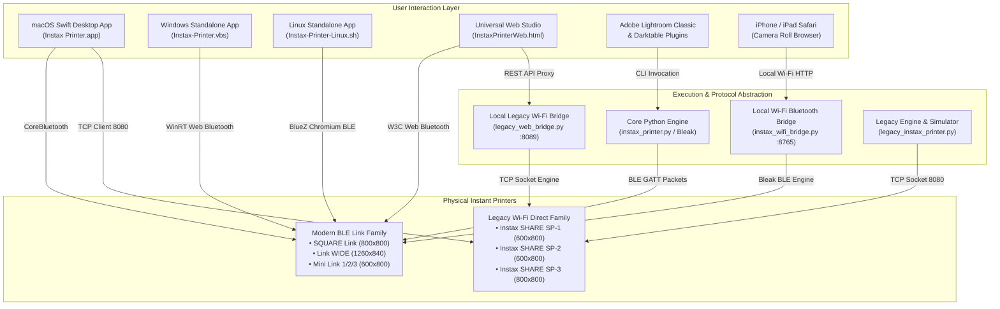
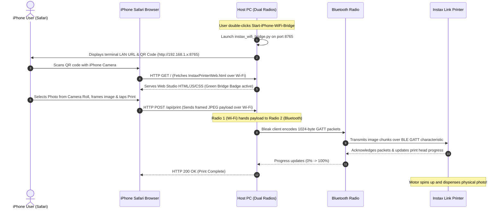
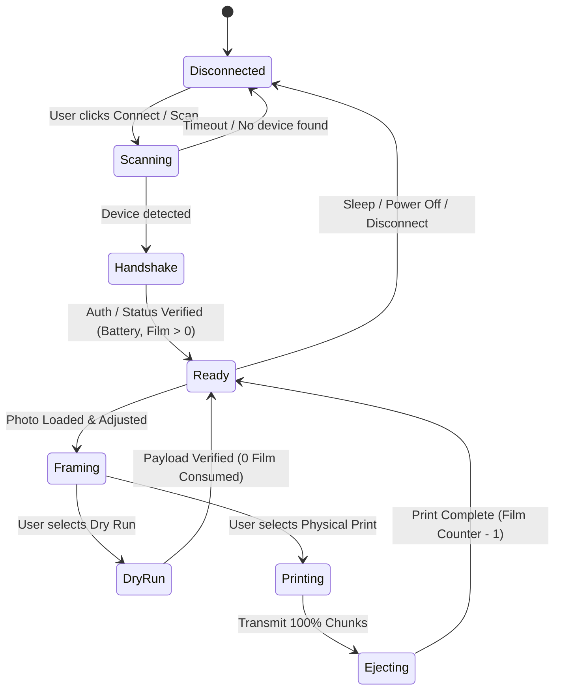

# 📘 Instax Offline Printer Suite — Comprehensive Software Documentation & Runbook
**Universal 100% Offline Printing for macOS, Windows, Linux, Web, and iOS**  
*Document Version: 2.0.0 • Standard: ISO/IEC/IEEE 26511 Software Documentation Specification • Repository Release: v2.0.0*

> 🔬 **Developer Notice**: For line-by-line annotated source code breakdowns, reverse-engineered protocol math, and function-level explanations, see the companion document:  
> 👉 **[Code Walkthrough & Developer Reference Manual (`CODE_WALKTHROUGH.md`)](CODE_WALKTHROUGH.md)**

---

## 📑 Table of Contents
1. [Document Overview & Scope](#1-document-overview--scope)
2. [Requirements Documentation](#2-requirements-documentation)
   - 2.1 [Business & Philosophical Objectives](#21-business--philosophical-objectives)
   - 2.2 [User Personas & Target Audience](#22-user-personas--target-audience)
   - 2.3 [User Stories](#23-user-stories)
   - 2.4 [Functional Requirements (FR)](#24-functional-requirements-fr)
   - 2.5 [Non-Functional Requirements (NFR)](#25-non-functional-requirements-nfr)
3. [Architecture & Design Documentation](#3-architecture--design-documentation)
   - 3.1 [High-Level System Topology](#31-high-level-system-topology)
   - 3.2 [Modern BLE Link Subsystem Architecture](#32-modern-ble-link-subsystem-architecture)
   - 3.3 [Legacy Wi-Fi Direct SHARE Subsystem Architecture](#33-legacy-wi-fi-direct-share-subsystem-architecture)
   - 3.4 [Dual-Radio Local Wi-Fi Bluetooth Bridge (iOS Safari Engine)](#34-dual-radio-local-wi-fi-bluetooth-bridge-ios-safari-engine)
   - 3.5 [State Machine & Sequence Diagrams](#35-state-machine--sequence-diagrams)
   - 3.6 [Architecture Decision Records (ADRs)](#36-architecture-decision-records-adrs)
4. [Technical Documentation](#4-technical-documentation)
   - 4.1 [Hardware Communication Protocols & Packet Encoders](#41-hardware-communication-protocols--packet-encoders)
     - 4.1.1 [Bluetooth Low Energy (GATT) Protocol Engine](#411-bluetooth-low-energy-gatt-protocol-engine)
     - 4.1.2 [Wi-Fi Direct TCP Socket Protocol Engine (SP-1, SP-2, SP-3)](#412-wi-fi-direct-tcp-socket-protocol-engine-sp-1-sp-2-sp-3)
   - 4.2 [Image Processing, Color Science & Planar RGB Matrices](#42-image-processing-color-science--planar-rgb-matrices)
   - 4.3 [Offline Camera-Scannable QR Code Engine](#43-offline-camera-scannable-qr-code-engine)
   - 4.4 [CLI & REST API Reference](#44-cli--rest-api-reference)
   - 4.5 [Automated Test Suite & Interactive Robot Verification](#45-automated-test-suite--interactive-robot-verification)
5. [User Documentation & Runbook](#5-user-documentation--runbook)
   - 5.1 [Prerequisites & Critical Hardware Requirements](#51-prerequisites--critical-hardware-requirements)
   - 5.2 [Platform Runbooks & Quickstart Tutorials](#52-platform-runbooks--quickstart-tutorials)
     - 5.2.1 [macOS Native App & Terminal Binaries](#521-macos-native-app--terminal-binaries)
     - 5.2.2 [Windows Zero-Install Desktop App & Python GUI](#522-windows-zero-install-desktop-app--python-gui)
     - 5.2.3 [Linux Desktop App, CLI & System Menu Integration](#523-linux-desktop-app-cli--system-menu-integration)
     - 5.2.4 [Web Studio & iPhone / iPad Safari Printing](#524-web-studio--iphone--ipad-safari-printing)
     - 5.2.5 [Adobe Lightroom Classic & Darktable Plugins](#525-adobe-lightroom-classic--darktable-plugins)
   - 5.3 [Operational Runbook & Troubleshooting Matrix](#53-operational-runbook--troubleshooting-matrix)
6. [Product Positioning & Market Analysis](#6-product-positioning--market-analysis)
   - 6.1 [Comparison: Official Mobile App vs Instax Offline Suite](#61-comparison-official-mobile-app-vs-instax-offline-suite)
   - 6.2 [Privacy, Security & Environmental Archival Benefits](#62-privacy-security--environmental-archival-benefits)
7. [Docs as Code & Release Engineering](#7-docs-as-code--release-engineering)
   - 7.1 [Continuous Integration & CodeQL Workflow](#71-continuous-integration--codeql-workflow)
   - 7.2 [Packaging & Distribution Pipeline](#72-packaging--distribution-pipeline)
   - 7.3 [Maintenance & Extension Guide](#73-maintenance--extension-guide)

---

## 1. Document Overview & Scope

### 1.1 Purpose
This comprehensive software engineering document serves as the canonical technical reference manual, architectural specification, user guide, and operational runbook for the **Instax Offline Printer Applications Suite**. It is designed to satisfy the software documentation standard described by IEEE/ISO guidelines, providing complete coverage across requirements, architecture, technical algorithms, end-user operations, and release workflows.

### 1.2 System Scope
The suite provides an independent, reverse-engineered, 100% offline desktop and web-based driver ecosystem for both modern Bluetooth Low Energy (BLE) and legacy Wi-Fi Direct instant photo printers manufactured by Fujifilm.

#### Supported Hardware Matrix
| Generation | Connection Medium | Models Supported | Print Media Format | Target Canvas Resolution |
| :--- | :--- | :--- | :--- | :--- |
| **Modern Link Series** | Bluetooth Low Energy (BLE GATT) | Instax SQUARE Link<br>Instax Link WIDE & WIDE 2<br>Instax Mini Link 1, 2, 3 & Link+ | SQUARE (62×62 mm)<br>WIDE (99×62 mm)<br>Mini (46×62 mm) | 800 × 800 px (1:1)<br>1260 × 840 px (3:2)<br>600 × 800 px (3:4) |
| **Legacy SHARE Series** | Wi-Fi Direct (TCP 8080 Socket) | Instax SHARE SP-1<br>Instax SHARE SP-2<br>Instax SHARE SP-3 SQUARE | Mini (SP-1 / SP-2)<br>SQUARE (SP-3) | 600 × 800 px (SP-1 / SP-2)<br>800 × 800 px (SP-3) |

---

## 2. Requirements Documentation

### 2.1 Business & Philosophical Objectives
1. **Zero External Dependency (100% Offline)**: Guarantee continuous operation with zero telemetry, zero cloud backends, zero user accounts, and zero internet connection requirements.
2. **Permanent Archival Longevity**: Protect consumer hardware investment against future obsolescence, operating system updates, or discontinuation of vendor mobile apps.
3. **Film Preservation (Zero-Waste Philosophy)**: Eliminate accidental film consumption caused by misframing, color clipping, or communication errors through **0-Film Dry Run verification** and accurate print simulators.
4. **Universal Cross-Platform Parity**: Provide identical printing capabilities across macOS, Windows 10/11, Linux distributions, web browsers, and iOS devices.

### 2.2 User Personas & Target Audience
- **Desktop Photographers & Curators**: Users managing high-resolution photo libraries in Apple Photos, Adobe Lightroom Classic, or Darktable who require direct, one-click physical printing from desktop workspaces.
- **Privacy-Conscious Creators**: Individuals who decline mobile app permission requirements (location tracking, contacts, telemetry, continuous cloud syncing) for local Bluetooth or Wi-Fi printing.
- **Event Organizers & Photo Booth Operators**: Operators requiring automated, rapid batch printing from laptops without pairing mobile devices or relying on venue internet.
- **Hardware Preservationists**: Owners of discontinued legacy Wi-Fi Direct printers (Instax SHARE SP-1, SP-2, SP-3) whose official companion apps have been degraded or abandoned on modern mobile OS versions.

### 2.3 User Stories
- **US-1 (Framing & Composition)**: *As a photographer, I want to pan, zoom, rotate, and letterbox my rectangular or panoramic photos with custom borders so that no critical compositional details are cropped.*
- **US-2 (Dry-Run Verification)**: *As a user with expensive instant film, I want to verify packet formatting and hardware handshake with 0 film dispensed before committing to a physical print.*
- **US-3 (Mobile Safari via Home Wi-Fi)**: *As an iPhone user, I want to print photos from my Camera Roll directly in regular Safari without installing third-party apps, using my home computer as a secure bridge.*
- **US-4 (Scannable QR Memories)**: *As a scrapbooking creator, I want to embed scannable QR codes containing audio links, secret notes, or web albums directly onto the instant photo.*
- **US-5 (Lightroom & Darktable Export)**: *As an editor, I want to right-click an image in Adobe Lightroom Classic or Darktable and beam it straight to my Instax printer with proper color profiling.*

### 2.4 Functional Requirements (FR)
- **FR-01 (BLE Device Discovery & Pairing)**: System shall scan and discover Instax BLE Link printers advertising service UUID `70954782-2d83-473d-9e5f-81e1d02d5273` without requiring OS-level system Bluetooth PIN pairing.
- **FR-02 (Wi-Fi Direct TCP Handshake)**: System shall establish TCP client socket connections to `192.168.0.251:8080` (or user-defined gateway) and authenticate using 4-digit PIN (default `1111`).
- **FR-03 (Telemetry Polling)**: System shall query and display real-time printer metrics: battery level, AC charging status, and remaining film count (0–10).
- **FR-04 (0-Film Dry-Run Mode)**: System shall offer a non-destructive verification toggle that validates all packet payload construction, image transformations, and socket transmission while halting before physical ejection.
- **FR-05 (Planar RGB Scanline Encoding)**: For legacy SHARE printers, system shall transform arbitrary image formats into 90° clockwise scanline-oriented planar RGB bitstreams formatted into 24 segments (SP-1/SP-2) or 32 segments (SP-3).
- **FR-06 (BLE JPEG Chunking)**: For BLE Link printers, system shall encode images into baseline JPEG structures and chunk payloads into 1024-byte BLE packets with sequential sequence IDs and 8-bit checksums.
- **FR-07 (Local Wi-Fi Bluetooth Bridge)**: System shall provide a local dual-radio HTTP daemon (`instax_wifi_bridge.py` / `legacy_web_bridge.py`) that serves the canonical offline web studio over LAN and bridges REST print calls to physical hardware.
- **FR-08 (Artistic Simulation Filters)**: System shall render real-time GPU/Canvas canvas filters (Normal, Fujifilm Intelligence Contrast, Rich B&W Monochrome, Vintage Sepia, and Vivid Velvia saturation).
- **FR-09 (Multi-Photo Collage Engine)**: System shall compose multi-photo layouts (Single, 2-Up Vertical, 2-Up Horizontal, 3-Photo Grid, 4-Photo 2×2 Grid, and 6-Photo Contact Sheet) with adjustable gutter spacing.
- **FR-10 (Embedded Offline QR Generator)**: System shall generate fully compliant Reed-Solomon QR codes (Error Correction Level M) embedded directly into canvas rendering across 5 positions and 3 card badge styles without network CDNs.
- **FR-11 (Virtual Hardware Simulator)**: System shall provide an integrated virtual Wi-Fi Direct socket server emulation (`VirtualInstaxShareServer`) on port 18080 for testing and software verification without physical printers.
- **FR-12 (One-Click Launchers)**: System shall provide native 1-click launchers for macOS (`.app` and `.command`), Windows (`.vbs` and `.bat`), and Linux (`.sh` and `.desktop`).
- **FR-13 (Analog Creative FX & Film Emulation Engine)**: System shall render analog instant film creative effects ported from PolaroidEngine: color warmth/temperature (-1.0 Cool Blue to +1.0 Golden Amber), radial lens vignette, analog light leaks (Red Film Burn, Golden Sunburst Flare, Sunset Coral & Rose, Prismatic Rainbow Spectrum) with 8-direction placement, silver halide tactile film grain, physical wear (dust motes, curved fibers, hairline scratches, chemical roller pressure mark), vintage glowing LED digital date stamps (Amber Gold, Ruby Red, Emerald Green, Crisp White), and a 1-click "Surprise Me!" retro randomizer.
- **FR-14 (Instant Film Emulation Presets & Cross-Tab Synchronization)**: System shall provide a 13-preset emulation catalog including `Default / Base (No Effects)`, Polaroid (SX-70, 600, I-Type, Spectra), Vintage Eras (1970s Golden Vintage, 1980s Retro Flash Pop, 1990s Point & Shoot, 1960s Monochrome Silver Halide), and Instax Profiles (instax-Rich, instax-Natural 3D-LUT, Instax Monochrome, Instax Warm Sepia). Selecting any preset shall automatically synchronize print mode, filter presets, exposure controls, and analog FX across Color/Filters and Analog FX tabs with bi-directional manual customization tracking.
- **FR-15 (Hand-Drawn Doodle Stickers, Emojis & Procedural Frames)**: System shall provide a complete creative overlays studio including hand-drawn vector doodle stickers (crowns, hats, glasses, arrows, stars, hearts, coffee), standard emoji stamps, user watermark/logo uploads, and 10 procedural decorative frames (Classic White, Obsidian Black, 35mm Sprockets, Gold Foil, Rose Gold, Rainbow, Sunset, Pastel Candy, Postage Stamp) rendered with zero external network or image dependencies.
- **FR-16 (Custom Banner Maker & Stylized Typography)**: System shall render custom text/emoji banners in 6 distinct styles (Ribbon, Pennant / Flag, Modern Pill, Vintage Label, Masking Tape, Speech Bubble) across 8 curated palettes with dynamic typography scaling and positioning.
- **FR-17 (Interactive Canvas Free Move & Target Focus Dragging)**: System shall support real-time on-canvas dragging (mouse and touch) for photo panning, sticker placement, and banner movement with smart hit-testing, Drag Target Focus mode selector (`Auto`, `Photo Pan`, `Sticker Move`, `Banner Move`), and bi-directional slider coordinate synchronization.
- **FR-18 (Headless JSC Engine Test Automation)**: Test automation shall verify Web Studio JavaScript syntax and runtime execution using headless JavaScriptCore (`jsc`) engine and W3C-compliant `HTMLParser` tokenization to guarantee zero syntax regressions and strict CodeQL compliance.

### 2.5 Non-Functional Requirements (NFR)
- **NFR-01 (Zero Network Calls)**: Application binaries and HTML web studios shall make zero HTTP/HTTPS requests to external hosts; all libraries must be bundled inline or locally.
- **NFR-02 (Low Latency)**: Image processing, resizing, and planar encoding shall complete in under 500ms on modern multicore hardware.
- **NFR-03 (Memory Footprint)**: GUI applications shall consume under 120 MB RAM during normal operation.
- **NFR-04 (Portability)**: Core Python engines shall execute identically across Python 3.8+ on macOS (Apple Silicon & Intel), Windows 10/11, and Linux (x86_64, aarch64, Raspberry Pi OS).
- **NFR-05 (Resilience)**: Network drops or Bluetooth packet timeouts shall trigger automatic socket teardown, clear internal state machines, and notify users via graphical status bars and debug logs.

---

## 3. Architecture & Design Documentation

### 3.1 High-Level System Topology



---

### 3.2 Modern BLE Link Subsystem Architecture
The Modern BLE subsystem interfaces with Fujifilm Link series printers via Bluetooth Low Energy (GATT).
- **Service UUID**: `70954782-2d83-473d-9e5f-81e1d02d5273`
- **Write Characteristic UUID**: `70954783-2d83-473d-9e5f-81e1d02d5273`
- **Notify / Read Characteristic UUID**: `70954784-2d83-473d-9e5f-81e1d02d5273`

Communication utilizes structured binary framing with leading synchronizers, two-byte command IDs, payload lengths, payload arrays, and 8-bit checksum footers.

---

### 3.3 Legacy Wi-Fi Direct SHARE Subsystem Architecture
Fujifilm Instax SHARE printers (SP-1, SP-2, and SP-3) broadcast a standalone IEEE 802.11 Wi-Fi Direct access point:
- **SSID Format**: `INSTAX-XXXXXXXX` (where X is an alphanumeric hardware serial)
- **Factory Wi-Fi Password**: `11111111`
- **Fixed Printer IP**: `192.168.0.251`
- **Fixed Printer TCP Port**: `8080`
- **Default Application PIN**: `1111`

The legacy architecture sends binary command packets prefixed with magic bytes `0x49 0x53 0x54 0x58` (`ISTX`), followed by two-byte command codes, payload length, session PIN, and scanline image chunks.

---

### 3.4 Dual-Radio Local Wi-Fi Bluetooth Bridge (iOS Safari Engine)
Apple disables the W3C Web Bluetooth API inside WebKit on iOS (preventing regular iPhone Safari from directly driving BLE GATT characteristics). To provide a **zero-install iPhone printing experience without downloading mobile apps**, the suite implements a dual-radio local proxy:



---

### 3.5 State Machine & Sequence Diagrams

#### Printer Connection & Print Lifecycle State Machine


---

### 3.6 Architecture Decision Records (ADRs)

#### ADR-01: Multi-Tiered Architecture (Native Swift + Python Bleak + Web Bluetooth)
- **Context**: Users operate a wide spectrum of machines: high-end macOS workstations, legacy Windows 10/11 laptops without Python, lightweight Linux distributions, and mobile iOS devices.
- **Decision**: Avoid monolithic heavy runtimes (e.g. Electron / 200MB Chromium wrappers). Provide:
  1. Native Swift binaries (`.app` + CLI) for macOS with direct Photos library integration.
  2. Zero-install HTML Web Bluetooth Studio for Chrome/Edge/Brave.
  3. Clean Python 3 + Bleak/Tkinter suite for cross-platform desktop integration.
- **Consequences**: Minimal binary sizes (repository under 15 MB total backup), instant startup, zero background CPU drain.

#### ADR-02: Single Source of Truth for Web Studios (Option 1 Architecture)
- **Context**: Duplicating `InstaxPrinterWeb.html` and `LegacyInstaxPrinterWeb.html` across `macOS/`, `Windows/`, and `Linux/` caused version divergence, stale bugfixes, and code maintenance overhead.
- **Decision**: Centralize canonical web studios inside dedicated directories:
  - `Web-Bluetooth-Offline/InstaxPrinterWeb.html`
  - `Legacy-Instax-Printer/Web-WiFi-Offline/LegacyInstaxPrinterWeb.html`
  Keep lightweight 1-click launchers (`.bat`, `.command`, `.sh`) in OS folders pointing back to these canonical files.
- **Consequences**: Bug fixes (like the v1.6.2 QR tab fix) instantly benefit all operating systems simultaneously.

#### ADR-03: Zero-CDN Embedded Offline Engine Strategy
- **Context**: Web apps frequently depend on CDN-hosted scripts (e.g., FontAwesome, Bootstrap, Google Fonts, external QR libraries). If a user is offline in a park, studio, or event, external scripts fail to load.
- **Decision**: All styling, vector icons, film simulation LUTs, and the QR generation engine (`qrcode-generator`) are embedded 100% inline within the single-file HTML document.
- **Consequences**: Guarantees unconditional offline availability even in airplane mode.

---

## 4. Technical Documentation

### 4.1 Hardware Communication Protocols & Packet Encoders

#### 4.1.1 Bluetooth Low Energy (GATT) Protocol Engine
The Link series printers receive data in structured frames over BLE GATT Write Characteristic `70954783-2d83-473d-9e5f-81e1d02d5273`.

##### Packet Framing Byte Structure
| Byte Offset | Field Name | Description | Example Value |
| :--- | :--- | :--- | :--- |
| `0x00` | Sync High | Fixed frame synchronizer byte 1 | `0xAA` |
| `0x01` | Sync Low | Fixed frame synchronizer byte 2 | `0x55` |
| `0x02` | Command Category | Major protocol category | `0xC0` (Print), `0xC4` (Telemetry) |
| `0x03` | Command Subcode | Specific instruction code | `0x01` (Status), `0x02` (Send Image) |
| `0x04 - 0x05` | Payload Length | 16-bit big-endian payload length ($N$) | `0x0400` (1024 bytes) |
| `0x06` to `0x06+N-1` | Payload Data | Raw command parameters or JPEG bytes | `...` |
| `0x06+N` | Checksum Footer | Sum8 / XOR verification checksum | `0xXX` |

##### Checksum Calculation
The packet checksum is calculated as the bitwise sum of all bytes from offset 2 through offset $5+N$, modulo 256:
$$\text{Checksum} = \left(\sum_{i=2}^{5+N} \text{Packet}[i]\right) \pmod{256}$$

---

#### 4.1.2 Wi-Fi Direct TCP Socket Protocol Engine (SP-1, SP-2, SP-3)
Legacy printers communicate over raw TCP stream sockets on port 8080.

##### Packet Header Structure (`ISTX`)
```c
struct InstaxWifiPacketHeader {
    uint8_t magic[4];       // 0x49, 0x53, 0x54, 0x58 ("ISTX")
    uint16_t command_code;  // 0x10 (Prepare), 0x20 (Image Data), 0x30 (Status), 0xC0 (Reset)
    uint16_t session_pin;   // Big-endian PIN (0x1111 = 4369)
    uint32_t payload_len;   // 32-bit big-endian payload byte count
};
```

##### Command Code Definitions
- `0x0010`: **Prepare Print Session** — Handshake and initialize print head parameters.
- `0x0020`: **Transmit Planar Scanline Segment** — Sends a block of planar RGB image data with segment index.
- `0x0030`: **Query Hardware Telemetry** — Requests remaining film count, battery level, and total lifetime print count.
- `0x00C0`: **Reset / Cancel Session** — Aborts active print sequence.

---

### 4.2 Image Processing, Color Science & Planar RGB Matrices

#### Resolution & Aspect Ratio Matrix
| Printer Model | Film Type | Pixel Dimensions | Aspect Ratio | Bytes per Planar Frame | Segments |
| :--- | :--- | :--- | :--- | :--- | :--- |
| **Instax Mini Link (1/2/3)** | Mini | 600 × 800 px | 3:4 Portrait | 1,440,000 bytes (decompressed) | N/A (JPEG Chunked) |
| **Instax Link WIDE (1/2)** | WIDE | 1260 × 840 px | 3:2 Landscape | 3,175,200 bytes (decompressed) | N/A (JPEG Chunked) |
| **Instax SQUARE Link** | SQUARE | 800 × 800 px | 1:1 Square | 1,920,000 bytes (decompressed) | N/A (JPEG Chunked) |
| **Instax SHARE SP-1 / SP-2** | Mini | 600 × 800 px | 3:4 Portrait | 1,440,000 bytes | 24 segments (60,000 B each) |
| **Instax SHARE SP-3** | SQUARE | 800 × 800 px | 1:1 Square | 1,920,000 bytes | 32 segments (60,000 B each) |

#### Planar RGB 90° Scanline Transformation
Unlike standard standard row-major interleaved RGB (`R1 G1 B1 R2 G2 B2...`), Instax SHARE print heads utilize **column-major planar RGB scanlines rotated 90° clockwise**:
1. Image is rotated 90° clockwise.
2. All Red channel scanlines are serialized sequentially.
3. Followed by all Green channel scanlines.
4. Followed by all Blue channel scanlines.

Mathematical coordinate mapping for image $(W \times H)$:
$$\text{Offset}_R(x, y) = y \cdot W + x$$
$$\text{Offset}_G(x, y) = (W \cdot H) + (y \cdot W + x)$$
$$\text{Offset}_B(x, y) = (2 \cdot W \cdot H) + (y \cdot W + x)$$

#### Film Simulation Presets
- **Fujifilm Intelligence**: Dynamic contrast S-curve with midtone contrast elevation ($\gamma = 1.15$).
- **Vivid Velvia**: Saturation scaling factor ($S = 1.35$), red and emerald green chrominance enhancement.
- **Rich B&W Monochrome**: ITU-R BT.601 luminance weighting:
  $$Y = 0.299R + 0.587G + 0.114B$$
- **Vintage Sepia**: Luminance matrix transformed into nostalgic warm dual-tone:
  $$R' = \min(255, 0.393R + 0.769G + 0.189B)$$
  $$G' = \min(255, 0.349R + 0.686G + 0.168B)$$
  $$B' = \min(255, 0.272R + 0.534G + 0.131B)$$

---

### 4.3 Offline Camera-Scannable QR Code Engine
The web studios embed a zero-dependency, pure-JavaScript implementation of the **Reed-Solomon QR Code Generator**:
- **Error Correction Level**: **Medium (M)** — Tolerates up to 15% data occlusion or film grain distortion.
- **Positions Supported**:
  - `bottomRight`: $X = W - S - M,\quad Y = H - S - M$
  - `bottomLeft`: $X = M,\quad Y = H - S - M$
  - `topRight`: $X = W - S - M,\quad Y = M$
  - `topLeft`: $X = M,\quad Y = M$
  - `bottomCenter`: $X = \frac{W - S}{2},\quad Y = H - S - M$
- **Size Options**: Small (15% canvas minimum), Medium (20% standard), Large (26% prominent).
- **Badge Styles**:
  - **Translucent Glass**: Frosted translucent card (`rgba(255, 255, 255, 0.92)`) with rounded corners ($r=12\text{px}$) and dark QR cells (`#000000`).
  - **Solid White Card**: Solid white background (`#ffffff`) for maximum scanner contrast.
  - **Dark Vignette**: Dark translucent badge (`rgba(0, 0, 0, 0.65)`) with white QR cells (`#ffffff`).

---

### 4.4 CLI & REST API Reference

#### Modern BLE CLI (`instax_printer.py`)
```bash
# General Syntax
python3 instax_printer.py [COMMAND] [OPTIONS] [IMAGE_PATH]

# Commands:
print        # Print photo to physical printer
status       # Query printer battery level and film count
serve        # Launch Local Wi-Fi Bluetooth Bridge server
preview      # Render local JPEG preview without printer hardware

# Image Framing & Geometry Flags:
--model      # 'square' (default), 'wide', or 'mini'
--fit        # 'crop' (fill), 'fit' (letterbox border), or 'stretch'
--rotate     # Rotation angle: 0, 90, 180, or 270 degrees
--dry-run    # 0-Film Dry Run verification mode (tests data flow without printing)
--port       # Port for bridge server (default: 8765)
--host       # Host binding for bridge server (default: 0.0.0.0)

# Analog Creative FX Flags (Zero External Dependencies):
--warmth           # Temperature shift from -1.0 (Cool Blue) to +1.0 (Golden Amber)
--vignette         # Lens optical edge shadow falloff (0.0 to 1.0)
--light-leak       # Leak type: 'none', 'burn', 'sunburst', 'sunset', 'rainbow'
--leak-placement   # 'auto', 'left', 'right', 'topRight', 'topLeft', 'bottomLeft', 'bottomRight', 'diagonal'
--leak-intensity   # Leak blending opacity (0.0 to 1.0, default: 0.70)
--grain            # Silver halide procedural crystal grain (0.0 to 1.0)
--wear             # Deterministic dust, fibers, and emulsion roller wear (0.0 to 1.0)
--date             # Retro 90s LED date stamp string (e.g. "'98 10 24")
--date-color       # LED color: 'amber', 'red', 'green', or 'white'
--date-placement   # Corner position: 'bottomRight', 'bottomLeft', 'topRight', 'topLeft'
```

#### Legacy Wi-Fi Direct CLI (`legacy_instax_printer.py`)
```bash
# General Syntax
python3 legacy_instax_printer.py [COMMAND] [OPTIONS] [IMAGE_PATH]

# Commands:
print        # Transmit image to SP-1, SP-2, or SP-3 over Wi-Fi Direct
status       # Query battery, film left, and total prints
scan         # Scan nearby airwaves for INSTAX-XXXXXXXX SSIDs
simulate     # Launch Virtual Instax SHARE Socket Server

# Flags:
--ip         # Printer IP (default: 192.168.0.251)
--port       # Printer TCP Port (default: 8080)
--pin        # Printer 4-digit PIN (default: 1111)
--model      # 'SP-1', 'SP-2' (default), or 'SP-3'
--dry-run    # 0-Film verification mode
```

#### Local Bridge REST API Endpoints
When running `instax_wifi_bridge.py` (`:8765`) or `legacy_web_bridge.py` (`:8089`):
- `GET /` — Serves canonical offline studio HTML.
- `GET /api/status` — Returns JSON hardware telemetry:
  ```json
  {
    "ok": true,
    "connected": true,
    "battery": 80,
    "charging": false,
    "film_count": 7,
    "model": "SQUARE Link"
  }
  ```
- `POST /api/print` — Accepts JSON payload with base64-encoded image:
  ```json
  {
    "image_base64": "data:image/jpeg;base64,...",
    "model": "wide",
    "dry_run": false
  }
  ```
- `GET /api/scan` — Returns list of detected Wi-Fi points and Instax networks:
  ```json
  {
    "ok": true,
    "networks_count": 12,
    "instax_networks": ["INSTAX-72019482"],
    "connected_ssid": "INSTAX-72019482"
  }
  ```

---

### 4.5 Automated Test Suite & Interactive Robot Verification

The repository contains two continuous verification suites:

#### 1. Unit & Protocol Integrity Test Suite (`test_suite.py`)
Runs automated non-GUI checks across 9 critical verification vectors:
- **Test 1**: Python Syntax Compilation across all 24 source files (`py_compile`).
- **Test 2**: Shell & `.command` script syntax validation using `bash -n`.
- **Test 3**: Canonical Web Architecture & MD5 integrity across platform bridge scripts.
- **Test 4**: Web Studios JavaScript Syntax & Execution Verification via headless macOS JavaScriptCore (`jsc`) engine using safe W3C-compliant `HTMLParser` tokenization (satisfies CodeQL `py/bad-tag-filter`).
- **Test 5**: Planar RGB Image Encoding math (SP-2 1,440,000 bytes vs SP-3 1,920,000 bytes).
- **Test 6–8**: Virtual Wi-Fi Direct Simulator socket handshake and 0-film dry-run transmission for SP-1, SP-2, and SP-3.
- **Test 9**: BLE Link Printer Preview Engine JPEG rendering.

```bash
# Execute Test Suite (9/9 Tests Verified)
python3 test_suite.py
```

#### 2. Headless Interactive Robot GUI Test Suite (`test_gui.py`)
Launches Tkinter GUIs programmatically, simulates user clicks, slider gestures, model selections, and socket dry-runs in memory:
- **Test 1**: Legacy Instax Wi-Fi GUI robot test (validates window geometry, simulator toggle, model switches, filter presets, rotation, collage templates, and TCP transfer).
- **Test 2**: Modern BLE Instax GUI robot test (validates canvas pan/zoom, printer format switches, contrast/brightness adjustments, and print queue).

```bash
# Execute GUI Robot Suite
python3 test_gui.py
```

---

## 5. User Documentation & Runbook

### 5.1 Prerequisites & Critical Hardware Requirements

> [!IMPORTANT]
> **Step 1: Update Printer Firmware Prior to Desktop Use!**
> * **Why**: Printers running factory firmware `0100` (especially Instax Link WIDE) have an internal buffer overflow bug in their Bluetooth chip, causing transfers from laptops to freeze at 3% or fail midway.
> * **Fix**: Open the official Fujifilm mobile app on your smartphone once, connect to the printer, go to **Settings $\to$ Firmware Update**, and update to **`0101`** (or newer). Once updated, the printer will work reliably with this desktop suite forever.

> [!IMPORTANT]
> **Step 2: Turn OFF Bluetooth on Your Phone / Tablet!**
> * **Why**: Instax printers only allow **ONE** active Bluetooth connection at a time. If your phone remains connected, the printer **stops advertising its beacons** and appears completely invisible to your computer.
> * **Fix**: Toggle Bluetooth OFF in your phone's quick settings, power cycle your printer, and click Connect on your computer.

---

### 5.2 Platform Runbooks & Quickstart Tutorials

#### 5.2.1 macOS Native App & Terminal Binaries
1. **Desktop App**: Open `macOS/` and double-click `Instax Printer.app` (for Link series) or `Legacy Instax Printer.app` (for SHARE series).
2. **Photos Library**: Click **Browse Photos** to access your native macOS Photos library and iCloud albums directly.
3. **Shortcuts**:
   - `⌘D` — Toggle Protocol Debug Console.
   - `⌘?` — Open Built-In Help & Guide.
   - `⌘O` — Open Image File.
4. **Command-Line CLI**:
   ```bash
   # Run standalone native binary (no Python needed)
   ./macOS/instax-square print ~/Desktop/photo.jpg --model wide
   ```

#### 5.2.2 Windows Zero-Install Desktop App & Python GUI
1. **Standalone App (Recommended)**: Open `Windows/` and double-click **`Instax-Printer.vbs`**.
   - Launches instantly in a borderless native window using Microsoft Edge's built-in WinRT engine.
   - Zero terminal popups, zero Python installations required.
2. **Python Launcher**: Double-click `Windows-Run.bat` to launch the Tkinter GUI.
3. **iPhone Bridge**: Double-click `Start-iPhone-WiFi-Bridge.bat` to print from your iPhone over home Wi-Fi.

#### 5.2.3 Linux Desktop App, CLI & System Menu Integration
1. **Standalone App (Recommended)**: Open `Linux/` and double-click **`Instax-Printer-Linux.sh`** (or run `./Instax-Printer-Linux.sh`).
   - Automatically detects Google Chrome, Chromium, Brave, or Edge and runs in app mode.
2. **Application Menu**:
   ```bash
   cp Linux/instax-printer.desktop ~/.local/share/applications/
   ```
3. **BlueZ Permissions Note**: Ensure your Linux user belongs to the `bluetooth` group:
   ```bash
   sudo usermod -a -G bluetooth $USER
   ```

#### 5.2.4 Web Studio & iPhone / iPad Safari Printing
1. **Online Studio**: [https://analogbits.github.io/Instax-Offline-Printer/](https://analogbits.github.io/Instax-Offline-Printer/)
2. **Offline Local Studio**: Double-click `Web-Bluetooth-Offline/InstaxPrinterWeb.html` in Chrome, Edge, Brave, or Opera.
3. **iPhone / iPad Safari Printing (Zero Apps)**:
   - On your Mac/Windows/Linux PC, run `Start-iPhone-WiFi-Bridge`.
   - Scan the terminal QR code with your iPhone camera to open `http://192.168.1.x:8765` in Safari.
   - Select photos from your iPhone Camera Roll and print directly!

#### 5.2.5 Adobe Lightroom Classic & Darktable Plugins
1. **Adobe Lightroom Classic**:
   - In Lightroom, go to **File $\to$ Plug-in Manager $\to$ Add**.
   - Select `Lightroom-Classic-Plugin/InstaxPrinter.lrplugin`.
   - Right-click any photo $\to$ **Export $\to$ Print with Instax Offline Printer**.
2. **Linux Darktable**:
   - Enable the Lua extension script located in `Linux/darktable/`.

---

### 5.3 Operational Runbook & Troubleshooting Matrix

| Symptom / Error | Root Cause | Resolution Step |
| :--- | :--- | :--- |
| **Printer not found / scan times out** | Smartphone or tablet is still connected via Bluetooth. | Turn OFF Bluetooth on your phone/tablet. Power cycle the Instax printer (hold power button 3s off, 3s on). Re-scan on computer. |
| **Link WIDE transfer hangs at 3%** | Factory printer firmware is outdated (`0100`). | Connect printer to official mobile app once and perform **Firmware Update** to `0101` or newer. |
| **Web Bluetooth error in Safari** | Apple disables Web Bluetooth in WebKit on macOS & iOS Safari. | **On Mac**: Use Google Chrome, Microsoft Edge, Brave, or Opera.<br>**On iPhone**: Run `Start-iPhone-WiFi-Bridge` on your computer, or open the page in the free [Bluefy Web BLE](https://apps.apple.com/app/bluefy-web-ble-browser/id1492822055) browser. |
| **SP-1/SP-2/SP-3 Wi-Fi drops immediately** | OS disconnects because the printer Wi-Fi provides no internet access. | In Windows/macOS Wi-Fi settings, check **"Connect automatically"** and decline suggestions to switch to another network. |
| **PIN Authentication Failed (Wi-Fi)** | Incorrect printer PIN. | Default PIN is `1111`. If altered by a previous owner, reset printer to factory defaults (hold power button down while inserting battery or consult manual). |
| **Photo appears clipped or black borders** | Fit mode set to Fill (Crop) vs Fit (Letterbox). | In Framing tab, switch **Fit Mode** from *Fill Canvas* to *Fit Entire Image*. Pick a custom matte background color using the color picker. |
| **QR code tab was blank (Legacy Web)** | Resolved in v1.6.2 (DOM ID mismatch). | Upgrade to `v1.6.2`. Tab now switches smoothly and embeds full offline scannable QR generation. |

---

## 6. Product Positioning & Market Analysis

### 6.1 Comparison: Official Mobile App vs Instax Offline Suite

| Dimension | Official Fujifilm Mobile Apps | Instax Offline Printer Suite |
| :--- | :--- | :--- |
| **Internet Dependency** | Requires active connection for firmware checks, telemetry, and initial account verification. | **100% Offline.** Zero network fetches. Functions indefinitely in airplane mode. |
| **Desktop Support** | **None.** Mobile-only (iOS / Android). | **Full Native Support** for macOS, Windows 10/11, Linux, and Web Browsers. |
| **Privacy & Telemetry** | Collects usage analytics, device identifiers, and location data (required for BLE on mobile). | **Zero Telemetry.** No accounts, no cookies, no tracking. |
| **Professional Workflows** | Requires exporting to phone Camera Roll before printing. | **Direct Lightroom Classic & Darktable plugins**, desktop drag-and-drop, and CLI scripting. |
| **Film Wastage Prevention** | No dry run feature. Failed prints consume expensive physical film. | **0-Film Dry Run Mode** verifies full packet transfer and handshake without dispensing film. |
| **Legacy Hardware Support** | Legacy SHARE apps (SP-1, SP-2, SP-3) are abandoned or incompatible with modern mobile OS updates. | **Full legacy support** with built-in Wi-Fi Direct scanners, simulators, and planar RGB encoders. |

### 6.2 Privacy, Security & Environmental Archival Benefits
- **Zero Electronic Waste**: Extends the operational lifespan of discontinued Instax SHARE and Link hardware by decades.
- **Film Conservation**: Instant film costs $0.75 to $1.50 per exposure. Previews, film simulations, and dry-run modes prevent accidental misprints.
- **Data Sovereignty**: Photos are processed entirely in local memory (RAM) and never uploaded to cloud staging servers.

---

## 7. Docs as Code & Release Engineering

### 7.1 Continuous Integration & CodeQL Workflow
The project follows strict **Docs as Code** and automated verification principles:
- **CI Workflow (`ci/ci.yml`)**:
  - Validates Python syntax across all scripts (`py_compile`).
  - Executes shell verification (`bash -n`).
  - Runs full 8-point protocol integrity suite (`test_suite.py`).
  - Executes automated headless robot tests (`test_gui.py`).
- **CodeQL Security Analysis**:
  - Configured with language matrix `['python']` targeting the cross-platform scripting core.

### 7.2 Packaging & Distribution Pipeline
Official releases are built and published with semantic versioning (`vMAJOR.MINOR.PATCH`):
1. **`Instax-Printer-Offline-Backup.zip`**: Complete offline archive of the entire repository and canonical web studios.
2. **`Legacy-Instax-Printer-macOS.zip`**: Standalone macOS package containing `Legacy Instax Printer.app`, `legacy-instax` CLI binary, `Start-iPhone-WiFi-Bridge.command`, and bundled web engine.
3. **`Instax-Printer-macOS.zip`**: Standalone modern BLE macOS app with native Photos library integration.
4. **`Instax-Lightroom-Classic-Plugin.zip`**: Packaged `.lrplugin` bundle for Adobe Lightroom Classic.

### 7.3 Maintenance & Extension Guide
- **Adding New Models**: To add support for future Instax models:
  1. Define model dimensions in `instax_printer.py` and `InstaxPrinterWeb.html` (`MODELS` map).
  2. Implement payload dimensions in `encode_planar_rgb()` or JPEG chunker.
  3. Update `test_suite.py` test cases to verify byte alignment and aspect ratio.
- **Modifying Web Studios**: All edits must be applied to canonical files in `Web-Bluetooth-Offline/` and `Legacy-Instax-Printer/Web-WiFi-Offline/`. Run `python3 test_suite.py` to confirm architecture compliance.

---

*Authored by the Instax Offline Printer Open Source Team • Licensed under the MIT License • Published at https://github.com/analogbits/Instax-Offline-Printer*
